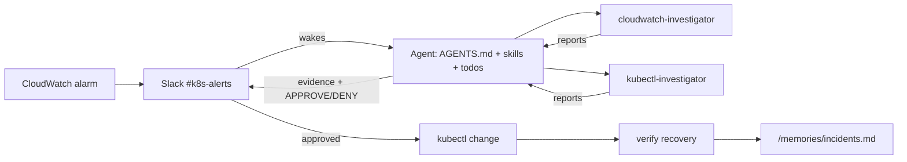

# K8s Deep Agent: an AI agent that fixes a Kubernetes incident

## What this is

An AI agent that gets a CloudWatch alarm, investigates a Kubernetes cluster, finds the root cause,
asks a human for approval, applies the fix and checks that it worked. It's built on
[Deep Agents](https://docs.langchain.com/oss/python/deepagents/overview) (LangGraph) and is designed
around one idea:

> **Agent = Model + Harness.** The model reasons. The harness is everything around it: skills,
> memory, planning, subagents, context control, tools, human approval, loop control and evals.

This repo is the demo for the talk at **Mysore**. It started as the demo for
[NZ Tech Rally 2026](https://nztechrally.nz) ("AI Agents in Your Kubernetes Cluster:
Troubleshooting at Scale, 24/7", Wellington, 15 May 2026).

## The harness pieces in this repo

| Piece | What it does | Where it lives |
|---|---|---|
| **Skills** | Runbooks the agent loads when they match the incident | `skills/universal/` (+ a cluster skill in `skills/clusters/<name>/`) |
| **Memory** | Who the agent is and what it learned from past incidents | `AGENTS.md` (always loaded) + `/memories/incidents.md` (file-based, `agent/agent.py`) |
| **Planning** | Breaks the incident into a todo list first | `write_todos`, required by the system prompt in `agent/agent.py` |
| **Subagents** | `cloudwatch-investigator` and `kubectl-investigator` run in parallel | `agent/subagents.py` |
| **Context** | Keeps the context window small | `agent/optimization.py` (tool output truncation) + the subagent report contract in `agent/subagents.py` |
| **Human in the loop** | Pauses before any change until a human approves | `interrupt_on` in `agent/agent.py` + Slack approval (`agent/tools/slack_tools.py`) |
| **Tools via MCP** | kubectl and CloudWatch tools from MCP servers | `agent/mcp_servers/` |
| **Loop control** | Stops the agent quitting early or looping forever | `agent/middleware.py` (`KeepLoopingMiddleware`) + `ModelCallLimitMiddleware` in `agent/subagents.py` |
| **Evals** | Score whether the agent did the right thing | `evals-agentcore/` (AgentCore Evaluations) + `agent/evals/` (local judges and metrics) |

## Try it in 30 minutes (no cluster needed)

The **AgentCore lab** runs this agent on
[Amazon Bedrock AgentCore](https://docs.aws.amazon.com/bedrock-agentcore/latest/devguide/what-is-bedrock-agentcore.html)
against a **recorded incident**. You don't need an EKS cluster, Slack, or an OpenAI key.

You deploy the agent twice, once with a hidden bug and once fixed, and watch the evals catch the
bug. Full details: [evals-agentcore/README.md](evals-agentcore/README.md).

### What you need

- An AWS account where you can create IAM roles, Lambda functions and AgentCore resources
- **Bedrock model access** to Claude Sonnet 5.5 (Bedrock console → **Model access**)
- A region with AgentCore Runtime, Gateway, Memory and Evaluations (we tested `ap-southeast-2`)
- Node 20+, Python 3.10+, [`uv`](https://docs.astral.sh/uv/), the AWS CLI
- `npm i -g @aws/agentcore@1.0.2 aws-cdk` (1.0.2 matches the CDK project; on 14 Nov 2026 1.0.3 failed to install, and 0.x is too old)
- CDK bootstrapped once: `cdk bootstrap aws://<account-id>/<region>`

> [!WARNING]
> **Cost and cleanup**
> - **Bedrock tokens:** one incident uses about **140k tokens** (one trace we measured: 141,733).
>   Use `--runs 1` to keep it small.
> - **Online evaluation** scores **100% of sessions** with LLM judges. After the lab, lower
>   `samplingRate` in `evals-agentcore/k8sHarness/agentcore/agentcore.json`, or delete it.
> - **Always run `./scripts/teardown.sh`** when you're done.

### Commands

```bash
export AWS_PROFILE=<your-profile>      # CloudShell already has credentials
export AWS_REGION=<your-region>        # e.g. ap-southeast-2

cd evals-agentcore
uv venv && source .venv/bin/activate && uv pip install boto3

# Set up the replayed cluster (Lambda + state) and your account details
python scripts/setup_replay.py

# 1. Deploy the agent AS SHIPPED (with the bug)
./scripts/sync_agent.sh as-shipped
(cd k8sHarness/agentcore/cdk && npm install)
(cd k8sHarness && agentcore deploy)

# 2. Run the incident and evaluate it
python scripts/run_incident.py --runs 1 --tag as-shipped
python scripts/evaluate.py --tag as-shipped --extra-evaluator harness_rules

# 3. Switch to the FIXED agent and do it again
./scripts/sync_agent.sh fixed
(cd k8sHarness && agentcore deploy)
python scripts/run_incident.py --runs 1 --tag fixed
python scripts/evaluate.py --tag fixed --extra-evaluator harness_rules

# 4. Clean up
./scripts/teardown.sh
```

### What to look for

- **`Builtin.GoalSuccessRate` goes from 0 to 1.** Both versions usually pick the right fix (scale
  `image-resizer` to 0). Only the fixed one checks that checkout latency recovered, because that
  step is in the runbook it couldn't load before.
- **"No skills available yet"** in the as-shipped agent's prompt (CloudWatch → GenAI Observability →
  your agent → Traces). The fixed agent lists 4 skills and loads `AGENTS.md`.
- **Nothing errors.** The bug is silent. Without evals you wouldn't notice it.

Our numbers from one full run: [evals-agentcore/RESULTS.md](evals-agentcore/RESULTS.md).

### Things that will surprise you

- **Memory takes about 15 minutes.** AgentCore Memory writes the long-term "episode" about
  15 minutes after a session ends. A second run straight away recalls nothing, so seed an episode
  or wait.
- **It's a replay.** The lab answers tool calls from a recorded incident, not a live cluster. That's
  why it's safe and repeatable.
- **The skill evaluators show "no results"**, even when the fixed agent reads a skill. RESULTS.md
  explains why.

## Which models were tested

| Path | Model | Status |
|---|---|---|
| AgentCore lab (`evals-agentcore/`) | `bedrock_converse:global.anthropic.claude-sonnet-5-5` | Tested end to end (the default in `agentcore.json`) |
| EKS + Slack (`agent/`, `infra/`) | `openai:gpt-5.4-mini` | Tested end to end (set in `infra/agent-deployment.yaml`) |
| EKS + Slack | `anthropic:...` | Supported in code, not validated end to end |

Set the model with the `AGENT_MODEL` env var (`provider:model`). If it isn't set, `agent/agent.py`
falls back to `openai:gpt-5-mini`, which is not the tested model, so always set it.

## Advanced: run it on a real EKS cluster with Slack

This is the original demo: a real cluster, real alarms, and approval buttons in Slack.

**You need:** an EKS cluster with an OIDC provider, CloudWatch Container Insights, `aws`, `kubectl`,
`docker`, a Slack app ([slack/bot-setup.md](slack/bot-setup.md)), Python 3.11+ and an OpenAI API key.

1. **Build your image.** The published image (`infra/agent-deployment.yaml`) was built before the
   skills fix, so build and push your own from this repo ([BUILD.md](BUILD.md)) and update `image:`.

2. **Secrets.**

   ```bash
   cp infra/agent-secrets.example.yaml infra/agent-secrets.yaml
   # fill in OPENAI_API_KEY and the SLACK_* values
   kubectl apply -f infra/agent-secrets.yaml
   ```

3. **Infrastructure.**

   ```bash
   AWS_PROFILE=<your-profile> AWS_REGION=<your-region> aws cloudformation deploy \
     --template-file infra/cloudformation/agent-iam.yaml \
     --stack-name k8s-agent-iam \
     --capabilities CAPABILITY_NAMED_IAM

   kubectl apply -f infra/priority-classes.yaml
   kubectl apply -f infra/redis-deployment.yaml        # LangGraph checkpointer only
   kubectl apply -f infra/mcp-gateway-deployment.yaml
   kubectl apply -f infra/agent-deployment.yaml
   ```

4. **Cluster skill.** Create `skills/clusters/<your-cluster>/SKILL.md`: your workloads, service
   tiers, priority classes, healthy thresholds and known incidents. `evals-agentcore/lab-cluster/SKILL.md`
   is a full example. Set `CLUSTER_SKILL_PATH` in `infra/agent-deployment.yaml` to it.

5. **Settings** (in `agent-deployment.yaml` and the secret):

   ```bash
   AGENT_MODEL=openai:gpt-5.4-mini
   CLUSTER_SKILL_PATH=./skills/clusters/<your-cluster>/SKILL.md
   SLACK_CHANNEL_ID=C...
   ```

6. **Test it.**

   ```bash
   curl -X POST http://<agent-service>/trigger \
     -H "Content-Type: application/json" \
     -d '{"alarm_name": "TestAlarm", "description": "Manual test trigger"}'
   ```

Point your CloudWatch alarms at the Slack channel (SNS → Lambda) and the agent wakes on every alert.
The universal skills don't need to change between clusters. The cluster skill supplies the specifics.

### How an incident flows on EKS



1. The alarm lands in Slack and wakes the agent.
2. The agent writes a todo list and sends both subagents off in parallel.
3. It forms a hypothesis, posts the evidence, then asks for approval.
4. The graph pauses at the change (`interrupt_on`) until a human clicks APPROVE or DENY.
5. On APPROVE it applies the change, checks recovery and writes the outcome to memory.

## Repository structure

```
.
├── AGENTS.md                    ← agent identity and rules (always loaded)
├── BUILD.md                     ← build and push the agent image
├── agent/
│   ├── main.py                  ← entry point (Flask /trigger + Slack + event loop)
│   ├── agent.py                 ← builds the Deep Agent: model, backends, skills, memory, HITL
│   ├── subagents.py             ← cloudwatch + kubectl investigators
│   ├── middleware.py            ← KeepLoopingMiddleware (loop control)
│   ├── optimization.py          ← tool output truncation, token cost tracking
│   ├── tools/slack_tools.py     ← post_to_slack, post_approval_request
│   ├── mcp_servers/             ← MCP client + server URLs
│   ├── evals/                   ← local judges, metrics, runner
│   ├── Dockerfile, requirements.txt, .env.example
├── skills/
│   ├── universal/               ← noisy-neighbor, node-disk-pressure, pod-priority-eviction,
│   │                              critical-service-protection
│   └── clusters/<name>/SKILL.md ← your cluster skill (create it)
├── infra/                       ← EKS manifests: agent, MCP gateway, Redis (checkpointer only),
│                                  priority classes, IAM (CloudFormation)
├── slack/                       ← Slack app setup + message templates
└── evals-agentcore/             ← the AgentCore lab: replayed incident, deploy, run, evaluate
```

Memory is file-based: the agent reads and edits `/memories/incidents.md` (an `emptyDir` on EKS,
`AGENT_MEMORY_DIR`). Redis is only the LangGraph checkpointer on EKS. On AgentCore, AgentCore Memory
does both jobs.

## References

- [Deep Agents docs](https://docs.langchain.com/oss/python/deepagents/overview)
- [What is Amazon Bedrock AgentCore?](https://docs.aws.amazon.com/bedrock-agentcore/latest/devguide/what-is-bedrock-agentcore.html)
- [AgentCore samples](https://github.com/awslabs/amazon-bedrock-agentcore-samples)
- [langgraph-checkpoint-aws](https://github.com/langchain-ai/langchain-aws/tree/main/libs/langgraph-checkpoint-aws) (AgentCore Memory checkpointer)
- [Strands Agents quickstart](https://strandsagents.com/latest/documentation/docs/user-guide/quickstart/)
- [MCP spec](https://modelcontextprotocol.io)
- [LangGraph human-in-the-loop](https://langchain-ai.github.io/langgraph/concepts/human_in_the_loop/)
- [CloudWatch Container Insights for EKS](https://docs.aws.amazon.com/AmazonCloudWatch/latest/monitoring/Container-Insights-setup-EKS-quickstart.html)
