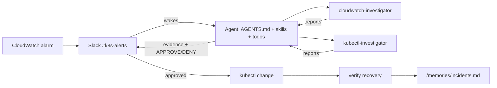

# K8s Deep Agent: an AI agent that fixes a Kubernetes incident

## What this is

An AI agent that gets a CloudWatch alarm, investigates a Kubernetes cluster, finds the root cause,
asks a human for approval, applies the fix and checks that it worked. It's built on
[Deep Agents](https://docs.langchain.com/oss/python/deepagents/overview) (LangGraph) and is designed
around one idea:

> **Agent = Model + Harness.** The model reasons. The harness is everything around it: skills,
> memory, planning, subagents, context control, tools, human approval, loop control and evals.

This repo is the demo for the talk at **Mysore**. It started as the demo for
[NZ Tech Rally 2026](https://nztechrally.nz) ("AI Agents in Your Kubernetes Cluster:
Troubleshooting at Scale, 24/7", Wellington, 15 May 2026).

## The harness pieces in this repo

| Piece | What it does | Where it lives |
|---|---|---|
| **Skills** | Runbooks the agent loads when they match the incident | `skills/universal/` (+ a cluster skill in `skills/clusters/<name>/`) |
| **Memory** | Who the agent is and what it learned from past incidents | `AGENTS.md` (always loaded) + `/memories/incidents.md` (file-based, `agent/agent.py`) |
| **Planning** | Breaks the incident into a todo list first | `write_todos`, required by the system prompt in `agent/agent.py` |
| **Subagents** | `cloudwatch-investigator` and `kubectl-investigator` run in parallel | `agent/subagents.py` |
| **Context** | Keeps the context window small | `agent/optimization.py` (tool output truncation) + the subagent report contract in `agent/subagents.py` |
| **Human in the loop** | Pauses before any change until a human approves | `interrupt_on` in `agent/agent.py` + Slack approval (`agent/tools/slack_tools.py`) |
| **Tools via MCP** | kubectl and CloudWatch tools from MCP servers | `agent/mcp_servers/` |
| **Loop control** | Stops the agent quitting early or looping forever | `agent/middleware.py` (`KeepLoopingMiddleware`) + `ModelCallLimitMiddleware` in `agent/subagents.py` |
| **Evals** | Score whether the agent did the right thing | `evals-agentcore/` (AgentCore Evaluations) + `agent/evals/` (local judges and metrics) |

## Three ways to run it

| | What you need | Time | Cost |
|---|---|---|---|
| **1. AgentCore lab** (start here) | An AWS account with Bedrock access | ~30 min (+12 min the first time in a region) | Bedrock tokens (~140k per incident) + small AgentCore charges |
| **2. On your laptop** with Docker | Docker + AWS credentials (or an OpenAI key) | ~10 min | Model tokens only |
| **3. On a real EKS cluster** with Slack | An EKS cluster, a Slack app | ~1 hour | Your cluster + model tokens |

All three replay or run the **same agent code** in `agent/`.

## 1. Try it in 30 minutes: the AgentCore lab (no cluster needed)

The lab runs this agent on
[Amazon Bedrock AgentCore](https://docs.aws.amazon.com/bedrock-agentcore/latest/devguide/what-is-bedrock-agentcore.html)
against a **recorded incident**. You don't need an EKS cluster, Slack, or an OpenAI key.

You deploy the agent twice, once with a hidden bug and once fixed, and watch the evals catch the
bug. Full details: [evals-agentcore/README.md](evals-agentcore/README.md).

### What you need

- An AWS account where you can create IAM roles, Lambda functions and AgentCore resources
- **Bedrock model access** to Claude Sonnet 5.5 (Bedrock console → **Model access**). Anthropic
  models ask for a short use-case form the first time.
- A region with AgentCore Runtime, Gateway, Memory and Evaluations. We tested `ap-southeast-2`
  (Sydney) and `ap-south-1` (Mumbai).
- Node 20+, Python 3.10+, [`uv`](https://docs.astral.sh/uv/) (`pip install uv`), the AWS CLI
- `npm i -g @aws/agentcore@1.0.2 aws-cdk` (1.0.2 matches the CDK project; 0.x is too old)
- CDK bootstrapped once per account and region: `cdk bootstrap aws://<account-id>/<region>`

`./scripts/preflight.sh` checks all of these in a few seconds and tells you how to fix anything
that's missing.

> [!WARNING]
> **Cost and cleanup**
> - **Bedrock tokens:** one incident uses about **140k tokens** (one trace we measured: 141,733).
>   Use `--runs 1` to keep it small.
> - **Online evaluation** scores 10% of sessions with LLM judges (`samplingRate` in
>   `evals-agentcore/k8sHarness/agentcore/agentcore.json`). Set it to 100 to see every run in the
>   dashboard, and remember it costs judge tokens per session.
> - **Always run `./scripts/teardown.sh`** when you're done. It removes everything the lab created.

### Commands

```bash
git clone https://github.com/dipinthomas/k8s-deep-agent.git
cd k8s-deep-agent/evals-agentcore

export AWS_PROFILE=<your-profile>      # skip in CloudShell: it already has credentials
export AWS_REGION=<your-region>        # e.g. ap-south-1

uv venv && source .venv/bin/activate && uv pip install boto3
./scripts/preflight.sh                 # fix anything marked ✗, then continue

# Set up the replayed cluster (Lambda + state) and write your account into the config
python scripts/setup_replay.py

# 1. Deploy the agent AS SHIPPED (with the bug)
./scripts/sync_agent.sh as-shipped
(cd k8sHarness/agentcore/cdk && npm install)
(cd k8sHarness && agentcore deploy)

# 2. Run the incident and evaluate it
python scripts/run_incident.py --runs 1 --tag as-shipped
python scripts/evaluate.py --tag as-shipped --extra-evaluator harness_rules

# 3. Switch to the FIXED agent and do it again
./scripts/sync_agent.sh fixed
(cd k8sHarness && agentcore deploy)
python scripts/run_incident.py --runs 1 --tag fixed
python scripts/evaluate.py --tag fixed --extra-evaluator harness_rules

# 4. Clean up
./scripts/teardown.sh
```

### What to look for

- **`Builtin.GoalSuccessRate` goes from 0 to 1.** Both versions usually pick the right fix (scale
  `image-resizer` to 0). Only the fixed one checks that checkout latency recovered, because that
  step is in the runbook it couldn't load before.
- **"No skills available yet"** in the as-shipped agent's prompt (CloudWatch → GenAI Observability →
  your agent → Traces). The fixed agent lists 4 skills and loads `AGENTS.md`.
- **Nothing errors.** The bug is silent. Without evals you wouldn't notice it.

Our numbers from one full run: [evals-agentcore/RESULTS.md](evals-agentcore/RESULTS.md).

### Things that will surprise you

- **Memory takes about 15 minutes.** AgentCore Memory writes the long-term "episode" about
  15 minutes after a session ends, so a second run straight away recalls nothing. For a demo, run
  `python scripts/seed_memory.py` first, then `run_incident.py --use-memory`.
- **The first run in a new region waits about 12 minutes.** The first `agentcore deploy` in a region
  turns on CloudWatch Transaction Search, which drops traces for its first ~12 minutes. Sessions run
  in that window can't be evaluated, so `run_incident.py` waits it out once and tells you why.
- **It's a replay.** The lab answers tool calls from a recorded incident, not a live cluster. That's
  why it's safe and repeatable.
- **The skill evaluators show "no results"**, even when the fixed agent reads a skill. RESULTS.md
  explains why.

### Using AWS CloudShell

CloudShell already has credentials, the AWS CLI, Python and Node. Its home folder is only 1 GB, and
the deploy needs about 600 MB (CDK `node_modules` plus the packaged agent), so clone into `/tmp`:
`cd /tmp && git clone ...`. `/tmp` is wiped when the session ends, so run the teardown in the same
session. Install `uv` with `pip install uv`. We haven't run the full lab in CloudShell yet; the
preflight check will tell you if something is missing.

## 2. On your laptop with Docker (no cluster, no Slack)

The smoke tests run the real agent image against the recorded incident, served as local MCP
servers. Good for checking a change before you deploy it.

```bash
docker build -t k8s-deep-agent:test -f agent/Dockerfile .
docker build -t k8s-mcp-gateway:test -f infra/mcp-gateway.Dockerfile .

tests/smoke/run.sh tools      # tools load, approval gate is armed (no model calls, free)
tests/smoke/run.sh sidecars   # same checks against the real kubectl + CloudWatch MCP servers

# Full incident with a real model (~140k tokens). Bedrock (default):
AWS_PROFILE=<your-profile> AWS_REGION=<your-region> tests/smoke/run.sh incident
# or OpenAI:
AGENT_MODEL=openai:gpt-5.4-mini OPENAI_API_KEY=sk-... tests/smoke/run.sh incident
```

`incident` prints what the agent would post to Slack, approves its request, and checks that the
skills loaded, it asked before changing anything, and the replayed cluster ends up fixed. CI runs
`tools` and `sidecars` on every pull request.

## 3. On a real EKS cluster with Slack

This is the original demo: a real cluster, real alarms, and approval buttons in Slack.

> [!CAUTION]
> The agent gets **cluster-admin** RBAC so it can investigate and fix anything. Every change still
> needs a human to click APPROVE, but use a test cluster, not production.

**You need:**

- An EKS cluster, with `kubectl` pointing at it (`aws eks update-kubeconfig --name <cluster>`)
- The cluster's IAM OIDC provider, created once with
  `eksctl utils associate-iam-oidc-provider --cluster <cluster> --approve`
- CloudWatch Container Insights: the `amazon-cloudwatch-observability` EKS add-on
- A Slack app ([slack/bot-setup.md](slack/bot-setup.md))
- A model: an OpenAI key, or Bedrock access (the IRSA role allows `bedrock:InvokeModel`)

**Steps:**

1. **Describe your cluster.** Copy `skills/clusters/example/SKILL.md` and fill it in: your services,
   which ones are critical, healthy thresholds, known noisy workloads
   ([how](skills/clusters/README.md)). No image rebuild needed.

2. **Secrets.**

   ```bash
   cp infra/agent-secrets.example.yaml infra/agent-secrets.yaml
   # fill in OPENAI_API_KEY (or leave empty for Bedrock) and the SLACK_* values
   ```

3. **Deploy.**

   ```bash
   export AWS_PROFILE=<your-profile> AWS_REGION=<your-region>
   export CLUSTER_NAME=<your-cluster>
   export CLUSTER_SKILL=path/to/your/SKILL.md
   # optional: export AGENT_MODEL=bedrock_converse:global.anthropic.claude-sonnet-5-5
   ./infra/deploy.sh
   ```

   `deploy.sh` refuses to run if your kube context isn't `CLUSTER_NAME`. It creates the IRSA role
   (CloudFormation stack `k8s-agent-iam-<cluster>`), then applies priority classes, Redis, the
   secret, your cluster skill and the agent. `RENDER_ONLY=1 ./infra/deploy.sh` shows the manifests
   without changing anything.

4. **Test it.**

   ```bash
   kubectl port-forward -n k8s-agent svc/k8s-agent 8080:8080 &
   curl -X POST http://localhost:8080/trigger \
     -H "Content-Type: application/json" \
     -d '{"alarm_name": "TestAlarm", "description": "Manual test trigger"}'
   ```

5. **Connect alarms.** Point your CloudWatch alarms at the Slack channel (SNS → AWS Chatbot or a
   Lambda). The agent wakes on every alert in the channel.

6. **Remove it:** `./infra/teardown.sh` (same env vars).

The published images are `dipinthomas2003/k8s-deep-agent:v119` and
`dipinthomas2003/k8s-mcp-gateway:v3` (amd64 + arm64). To use your own, see [BUILD.md](BUILD.md) and
set `AGENT_IMAGE` / `MCP_IMAGE`.

### How an incident flows on EKS



1. The alarm lands in Slack and wakes the agent.
2. The agent writes a todo list and sends both subagents off in parallel.
3. It forms a hypothesis, posts the evidence, then asks for approval.
4. The graph pauses at the change (`interrupt_on`) until a human clicks APPROVE or DENY.
5. On APPROVE it applies the change, checks recovery and writes the outcome to memory.

## Models

Set the model with `AGENT_MODEL` (`provider:model`).

| Model | Where it was tested |
|---|---|
| `bedrock_converse:global.anthropic.claude-sonnet-5-5` | AgentCore lab, end to end (default in `agentcore.json`); the agent image, full incident via `tests/smoke/run.sh incident` |
| `openai:gpt-5.4-mini` | EKS with Slack, end to end on the earlier v118 image. The default if `AGENT_MODEL` isn't set. |
| `anthropic:...` | Supported in code, not validated end to end |

## Versions

Everything is pinned, so a build next month behaves like the one we tested:

- **Python:** `agent/requirements.in` → locked `agent/requirements.txt` (deepagents 0.7.35,
  langchain 1.5.0, langgraph 1.2.22, mcp 1.30.0). The lab's `pyproject.toml` uses the same versions.
- **MCP sidecars:** mcp-server-kubernetes 3.5.0, cloudwatch-mcp-server 0.0.25, supergateway 3.4.3
  (`infra/mcp-gateway.Dockerfile`).
- **Images:** fixed tags, never `:latest`.
- **CLI:** `@aws/agentcore@1.0.2`.

To upgrade, bump the versions, run `tests/smoke/run.sh sidecars` and `incident`, then the lab. The
approval gate matches tool **names**, so a sidecar upgrade that renames a tool is exactly what the
smoke tests catch.

## Repository structure

```
.
├── AGENTS.md                    ← agent identity and rules (always loaded)
├── BUILD.md                     ← build and publish the images
├── agent/
│   ├── main.py                  ← entry point (Flask /trigger + Slack + event loop)
│   ├── agent.py                 ← builds the Deep Agent: model, backends, skills, memory, HITL
│   ├── subagents.py             ← cloudwatch + kubectl investigators
│   ├── middleware.py            ← KeepLoopingMiddleware (loop control)
│   ├── optimization.py          ← tool output truncation, token cost tracking
│   ├── tools/slack_tools.py     ← post_to_slack, post_approval_request
│   ├── mcp_servers/             ← MCP client + server URLs
│   ├── evals/                   ← local judges, metrics, runner
│   ├── requirements.in/.txt     ← dependencies (.txt is the lockfile)
│   └── Dockerfile, .env.example
├── skills/
│   ├── universal/               ← noisy-neighbor, node-disk-pressure, pod-priority-eviction,
│   │                              critical-service-protection
│   └── clusters/                ← how to write your cluster skill + an example
├── infra/
│   ├── deploy.sh, teardown.sh   ← one-command EKS deploy / removal
│   ├── agent-deployment.yaml    ← template: agent + MCP sidecars + RBAC
│   ├── redis-deployment.yaml    ← LangGraph checkpointer only
│   ├── priority-classes.yaml, agent-secrets.example.yaml
│   ├── mcp-gateway.Dockerfile   ← MCP sidecar image
│   └── cloudformation/agent-iam.yaml ← IRSA role
├── evals-agentcore/             ← the AgentCore lab: replayed incident, deploy, run, evaluate
├── tests/smoke/                 ← Docker smoke tests (replayed incident as local MCP servers)
├── slack/                       ← Slack app setup + message templates
└── .github/workflows/ci.yml     ← checks + smoke tests; publishes images on agent-v*/mcp-v* tags
```

Memory is file-based: the agent reads and edits `/memories/incidents.md` (an `emptyDir` on EKS,
`AGENT_MEMORY_DIR`). Redis is only the LangGraph checkpointer on EKS. On AgentCore, AgentCore Memory
does both jobs.

## References

- [Deep Agents docs](https://docs.langchain.com/oss/python/deepagents/overview)
- [What is Amazon Bedrock AgentCore?](https://docs.aws.amazon.com/bedrock-agentcore/latest/devguide/what-is-bedrock-agentcore.html)
- [AgentCore samples](https://github.com/awslabs/amazon-bedrock-agentcore-samples)
- [langgraph-checkpoint-aws](https://github.com/langchain-ai/langchain-aws/tree/main/libs/langgraph-checkpoint-aws) (AgentCore Memory checkpointer)
- [Strands Agents quickstart](https://strandsagents.com/latest/documentation/docs/user-guide/quickstart/)
- [MCP spec](https://modelcontextprotocol.io)
- [LangGraph human-in-the-loop](https://langchain-ai.github.io/langgraph/concepts/human_in_the_loop/)
- [CloudWatch Container Insights for EKS](https://docs.aws.amazon.com/AmazonCloudWatch/latest/monitoring/Container-Insights-setup-EKS-quickstart.html)
